# Generador de programas VM

## Qué hace la app

Permite preparar el programa de Vida y Ministerio Cristianos: carga las partes de la guía de actividades, asigna participantes y guarda el resultado para imprimir o descargar como PDF.

[Abrir la app](https://polo123456789.github.io/generador-programas-vm/)

## Cómo usarla

### 1. Crear asignados

En **Gestionar Participantes**, añade a cada persona y marca las partes que puede realizar.

### 2. Descargar programa

Copia el enlace de la guía de actividades desde WOL, pégalo en la app y pulsa **Cargar**.

### 3. Llenar programa

Pulsa **Elegir** en cada parte para asignar a los participantes. Consulta el historial pasando el cursor sobre los textos subrayados y revisa los avisos. Para cambiar una asignación, pulsa **Cambiar**.

Cuando termines, pulsa **Imprimir / PDF**. El trabajo se guarda en el navegador; puedes descargar un respaldo desde **Gestionar Participantes**.

## Características

Las capturas usan nombres ficticios y situaciones de ejemplo.

<table>
  <tr>
    <td width="50%" valign="top">
      <h3>Historial por cargo al pasar el cursor</h3>
      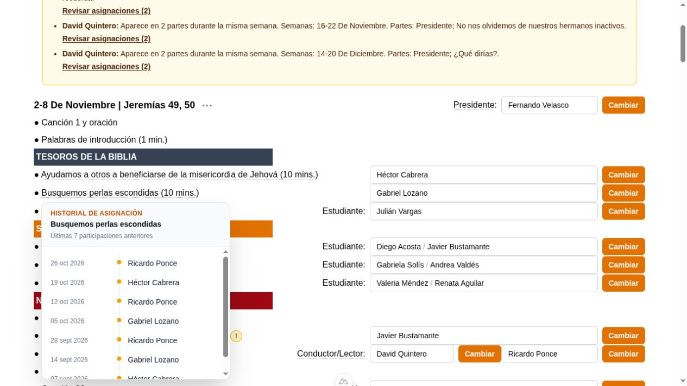
    </td>
    <td width="50%" valign="top">
      <h3>Historial de la semana al pasar el cursor</h3>
      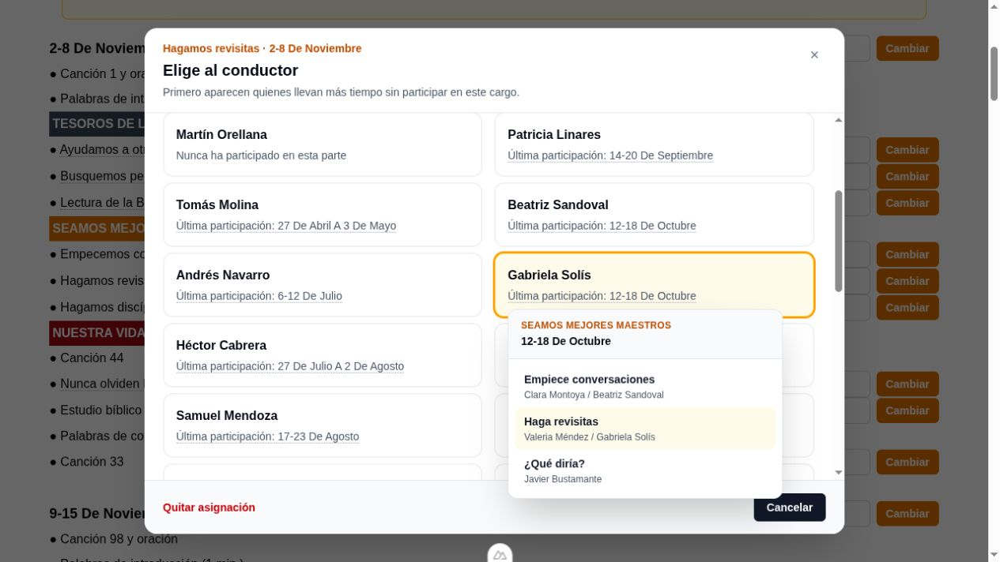
    </td>
  </tr>
  <tr>
    <td width="50%" valign="top">
      <h3>Selección según la última participación</h3>
      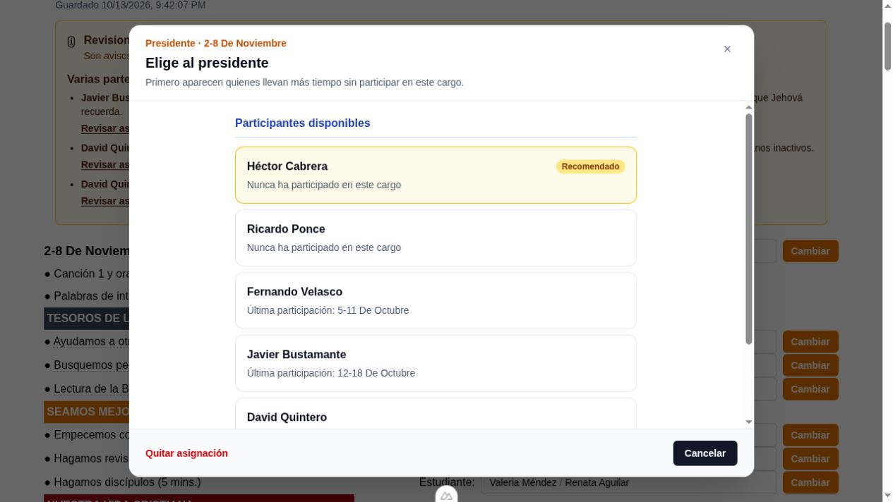
    </td>
    <td width="50%" valign="top">
      <h3>Selección de parejas</h3>
      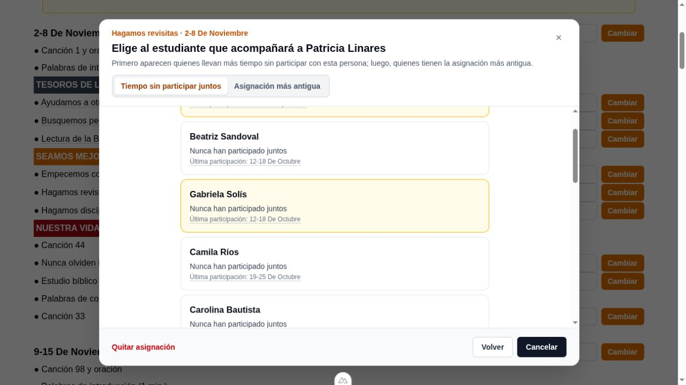
    </td>
  </tr>
  <tr>
    <td width="50%" valign="top">
      <h3>Partes con uno o dos estudiantes</h3>
      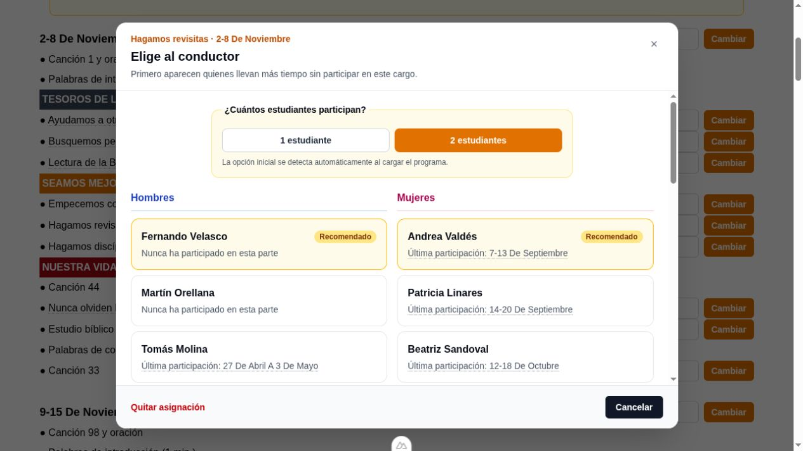
    </td>
    <td width="50%" valign="top">
      <h3>Participantes y aptitudes</h3>
      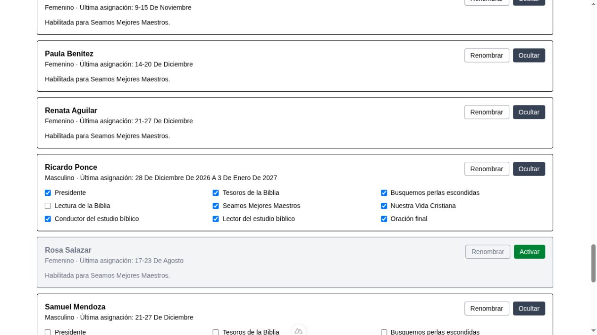
    </td>
  </tr>
  <tr>
    <td width="50%" valign="top">
      <h3>Progreso y asignaciones pendientes</h3>
      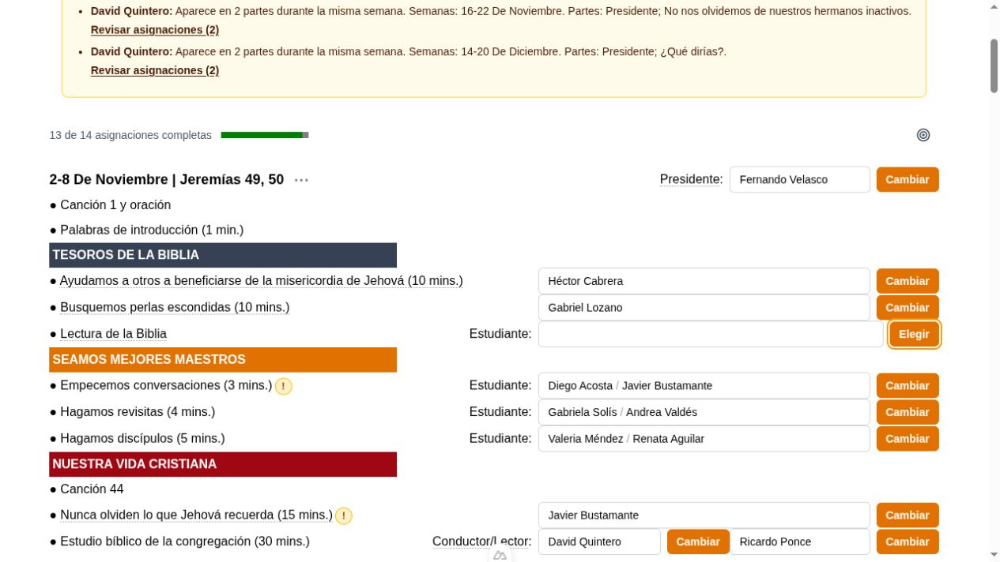
    </td>
    <td width="50%" valign="top">
      <h3>Reuniones canceladas y visitas del superintendente</h3>
      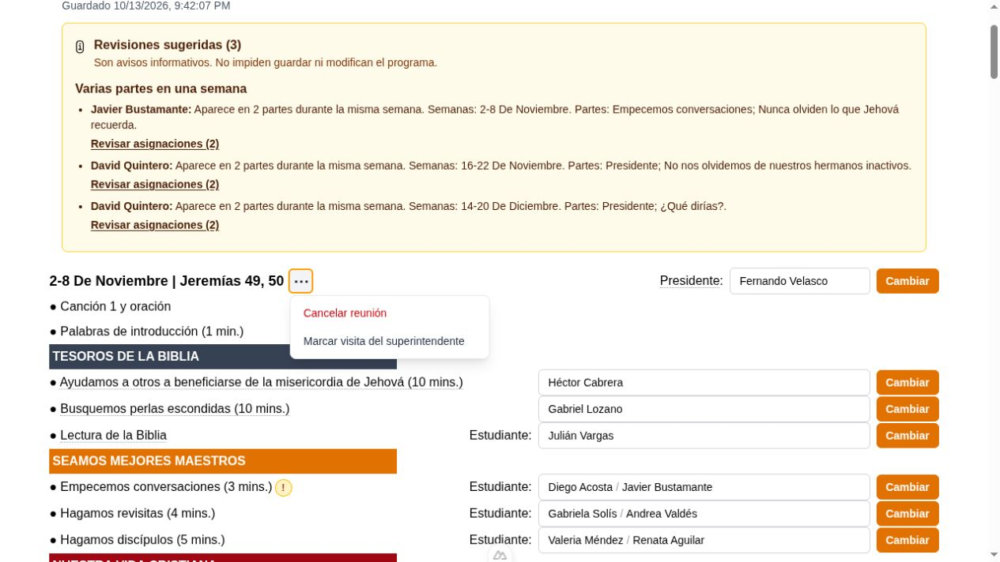
    </td>
  </tr>
  <tr>
    <td width="50%" valign="top">
      <h3>Avisos sobre el reparto de asignaciones</h3>
      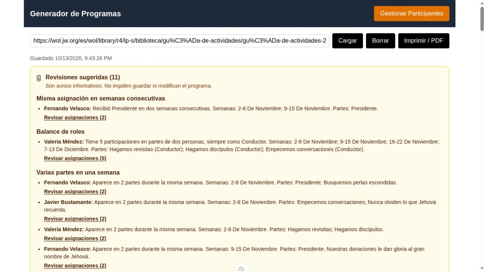
    </td>
    <td width="50%" valign="top">
      <h3>Avisos sobre parejas y aptitudes</h3>
      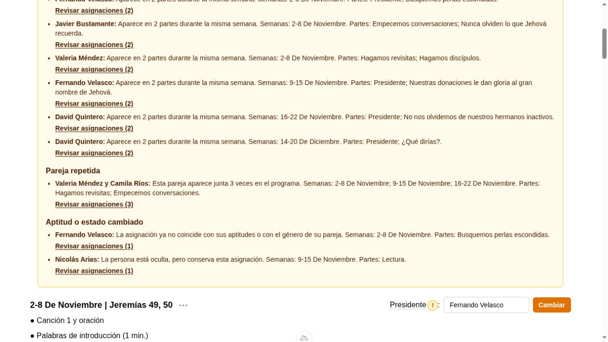
    </td>
  </tr>
  <tr>
    <td width="50%" valign="top">
      <h3>Avisos junto a cada parte</h3>
      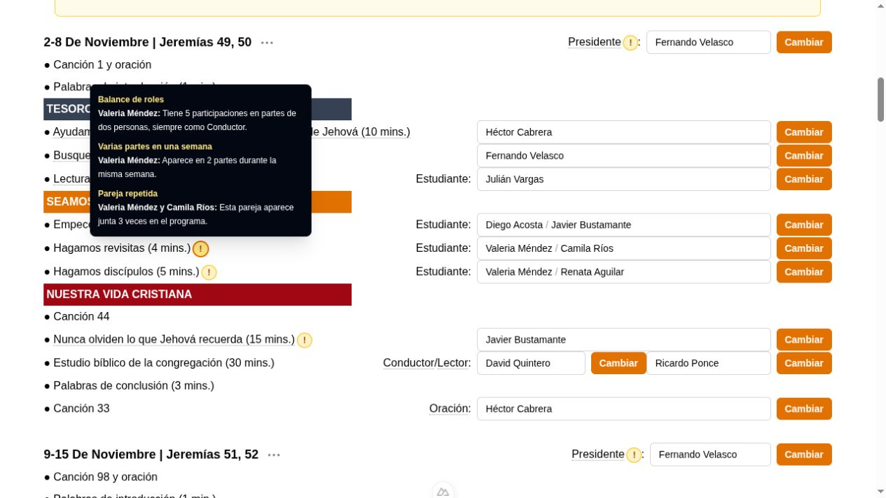
    </td>
    <td width="50%" valign="top">
      <h3>Respaldo y restauración</h3>
      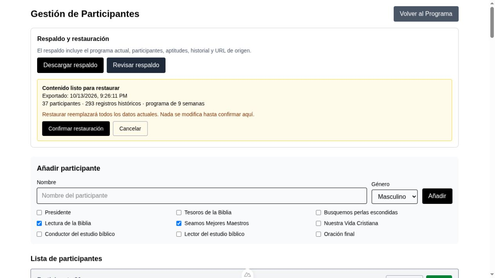
    </td>
  </tr>
</table>
